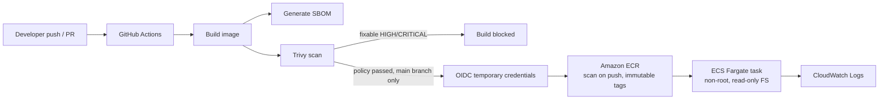

# Cloud-Native Workload Security on AWS

A secure container deployment on **Amazon ECS Fargate** with **Amazon ECR**, provisioned with **Terraform** and delivered through a **GitHub Actions** pipeline that scans images, generates an SBOM and blocks risky builds before they reach AWS.

## What this project demonstrates

- Least-privilege IAM: a scoped task execution role and a task role with **no permissions**
- Network restriction: security group allows inbound only from one IP, outbound only on HTTPS
- Container hardening: non-root user, minimal base image, read-only root filesystem, all Linux capabilities dropped
- Centralized logging with CloudWatch Logs
- CI/CD security: vulnerability scanning, SBOM generation and a configurable policy that blocks high-risk images
- Keyless deployment: GitHub OIDC replaces long-lived AWS access keys

## Architecture



## Security controls

| Area | Control | Evidence |
|---|---|---|
| Container | Non-root user (UID 10001), slim base image, pip/setuptools removed from runtime image | `docs/screenshots/02-container-runs-as-non-root.JPG` |
| Runtime | Read-only root filesystem, all capabilities dropped, not privileged | `docs/screenshots/09-task-hardening-settings.JPG` |
| IAM | Execution role scoped to one ECR repo and one log group; task role has no permissions | `docs/screenshots/05-least-privilege-execution-policy.JPG` |
| Network | Inbound 8080 from a single IP only; outbound HTTPS only | `docs/screenshots/04-security-group-rules.JPG` |
| Registry | Immutable tags, scan on push, lifecycle policy | `docs/screenshots/03-ecr-repository-settings.JPG` |
| Logging | Container logs shipped to CloudWatch, 7-day retention | `docs/screenshots/08-cloudwatch-logs.JPG` |
| Pipeline auth | GitHub OIDC, trust limited to this repo's `main` branch | `docs/screenshots/10-github-oidc-trust-policy.JPG` |

## CI/CD pipeline

Every push and pull request: build image, generate a CycloneDX SBOM (uploaded as a build artifact), run a full Trivy report, then enforce a vulnerability policy. Only pushes to `main` that pass the policy are authenticated to AWS and pushed to ECR.

**Blocking policy:** the build fails on fixable HIGH and CRITICAL vulnerabilities. Findings with no available fix are reported but do not block. The blocked severities are configurable with the repository variable `TRIVY_BLOCK_SEVERITY` (default `CRITICAL,HIGH`).

| Stage | Evidence |
|---|---|
| Report-only scan | `docs/screenshots/11-trivy-scan-report-only.JPG` |
| Build blocked by policy | `docs/screenshots/12-pipeline-blocked-by-policy.JPG` |
| Configurable severity | `docs/screenshots/13-configurable-policy-critical-only.JPG` |
| Fixed image passes | `docs/screenshots/14-pipeline-passes-policy.JPG` |
| SBOM artifact | `docs/screenshots/15-sbom-artifact.JPG` |
| Pushed to ECR via OIDC | `docs/screenshots/16-pipeline-pushes-to-ecr.JPG` |
| Vulnerable PR blocked | `docs/screenshots/17-blocked-vulnerable-pr.JPG` |
| AWS steps skipped on block | `docs/screenshots/18-aws-steps-skipped-on-block.JPG` |

## Findings and how they were fixed

The first policy run blocked the build on one fixable Debian finding (`zlib1g`) and five fixable Python findings in packaging tools bundled with the base image. Fixes: apply OS security updates at build time, and remove pip, setuptools and wheel from the runtime image. The next run passed.

## Repository layout

```
app/            Flask application
Dockerfile      Hardened image build
terraform/      ECR, VPC, security group, IAM, logging, ECS, GitHub OIDC
.github/workflows/pipeline.yml   CI/CD pipeline
docs/screenshots/                Evidence
```

## Deploy it yourself

1. Create an IAM user and configure the AWS CLI (`aws configure`)
2. In `terraform/`, create `terraform.tfvars` with `allowed_ingress_cidr`, `github_repository` and `github_oidc_subject` (no secrets, but keep it out of Git)
3. `terraform init && terraform apply`
4. Add the `AWS_ROLE_ARN` repository secret (output: `github_pipeline_role_arn`)
5. Push to `main`; the pipeline builds, scans and pushes the image
6. Clean up with `terraform destroy`

## Design decisions and trade-offs

- **Public subnets, no NAT gateway or load balancer:** keeps cost near zero for a demo. The task has a public IP, but the security group admits only one address. A production version would use private subnets, VPC endpoints and a load balancer with TLS.
- **Trivy for both scanning and SBOM:** one trusted tool in the pipeline. ECR scan on push provides a second opinion.
- **Unfixed findings do not block:** blocking on issues nobody can patch would fail every build. They are still reported.
- **`force_delete` on the ECR repo:** convenient for teardown in a demo; omit in production.

## Possible improvements

- Pin GitHub Actions to commit SHAs
- Sign images (cosign) and verify before deploy
- Private subnets, VPC endpoints, load balancer with TLS
- Automated deploy to ECS after the push